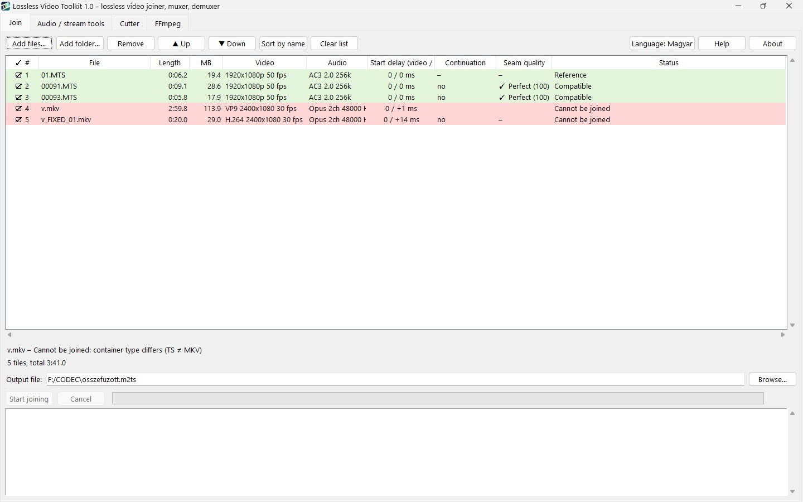
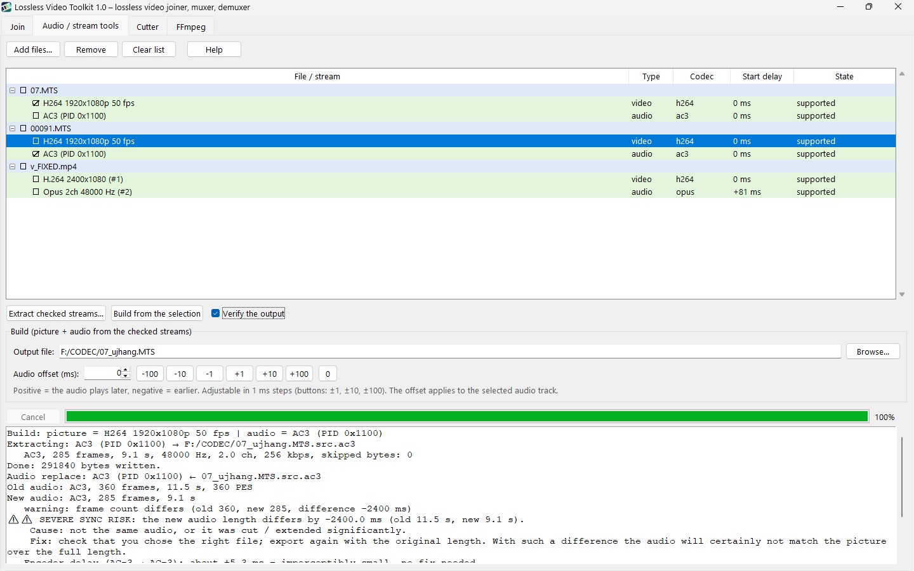
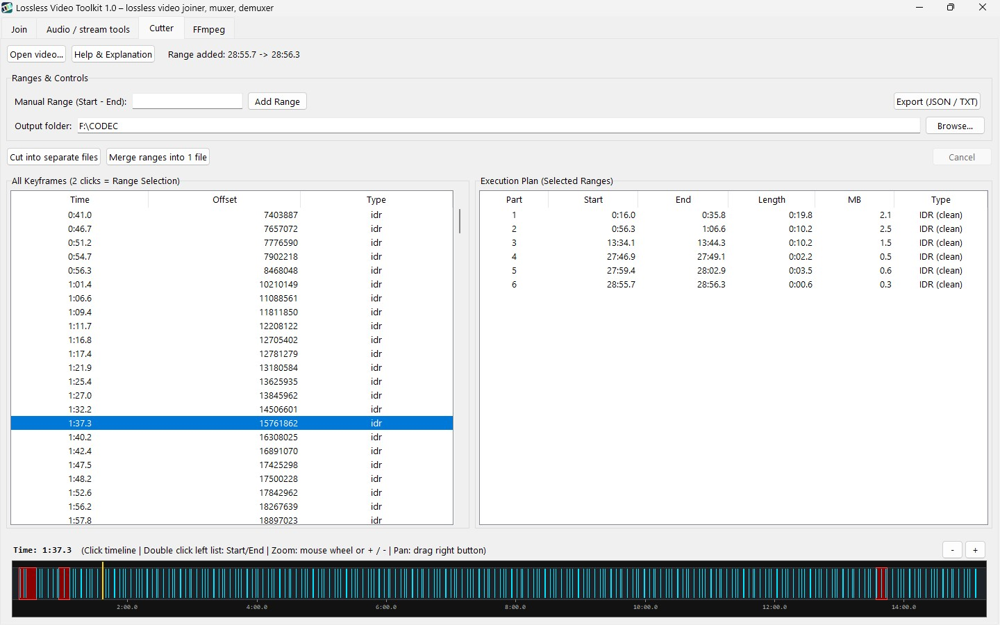
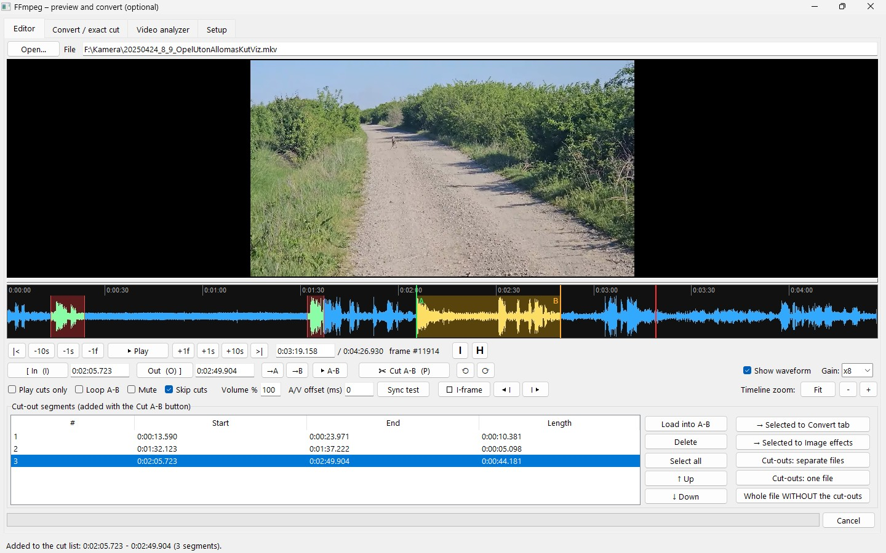
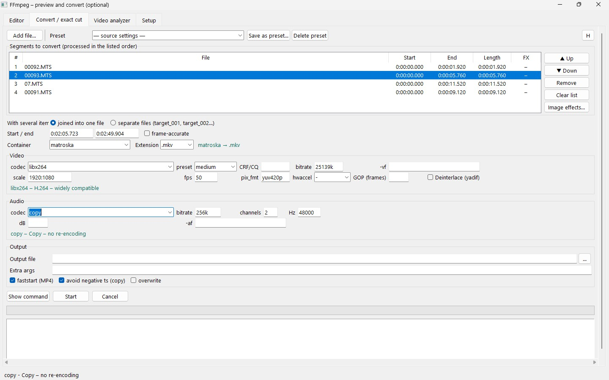
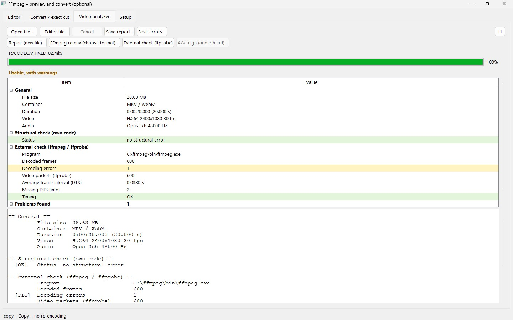
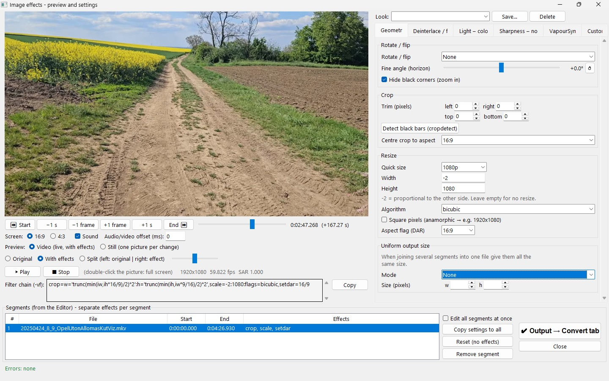

# Lossless Video Toolkit (LVT)

[](LICENSE)


A video toolkit for Windows that works on your recordings **without quality loss**: join, cut, extract, analyze and (optionally) convert video files. It started as a joiner for AVCHD (`.MTS` / `.M2TS`) camera files and grew into a small editing suite built around lossless stream copying, with FFmpeg as an optional extra.

<!-- Add screenshots here, e.g.:

-->

## Contents

- [Features at a glance](#features-at-a-glance)
- [Download and quick start](#download-and-quick-start)
- [Joiner and extractor](#joiner-and-extractor)
- [Cutter and Smart Cut](#cutter-and-smart-cut)
- [FFmpeg window](#ffmpeg-window)
  - [Editor](#editor)
  - [Saving cuts](#saving-cuts)
  - [Convert / exact cut](#convert--exact-cut)
  - [Image effects and VapourSynth](#image-effects-and-vapoursynth)
  - [Video analyzer](#video-analyzer)
  - [Setup](#setup)
- [Keyboard shortcuts](#keyboard-shortcuts)
- [External programs (not included)](#external-programs-not-included)
- [Run from source](#run-from-source)
- [Building the exe](#building-the-exe-windows)
- [Project layout](#project-layout)
- [License and disclaimer](#license-and-disclaimer)

## Features at a glance

| Area | What it does | Needs FFmpeg? |
|---|---|:---:|
| **Joiner** | Joins files losslessly, no re-encoding | No |
| **Extractor** | Extracts audio or video streams, replaces audio, verifies the result | No |
| **Cutter** | Lossless cutting on keyframes | No |
| **Smart Cut** | Frame-accurate cuts: re-encodes only the cut edges, copies everything between | Yes |
| **Editor** | Live preview, waveform timeline, frame-by-frame stepping, A/B markers, cut list with undo/redo | Yes |
| **Convert / exact cut** | Re-encoding with presets, one-pass cut-and-join, container and codec choice | Yes |
| **Image effects** | Resize, crop, rotate, deinterlace, colour, sharpen, denoise, VapourSynth filters, custom `-vf` | Yes |
| **Analyzer** | Checks the structure and timing of a video file | Partly |
| **Command line** | Joiner without the GUI (`LVT_cli.exe`) | No |

Supported containers for joining: AVCHD (`.MTS` / `.M2TS`), MP4 / MOV, MKV / WebM, MPEG-PS and DVD VOB.

## Download and quick start

1. Download the latest `LVT-…-win64.zip` from the **Releases** page (or from SourceForge).
2. Extract the **whole folder** (the `_internal` folder next to `LVT.exe` is required).
3. Run `LVT.exe`.

The interface starts in English. The language can be switched in the program, and the choice is remembered.

The joiner, extractor and cutter work right away. FFmpeg-based features (Smart Cut, the FFmpeg window, image effects) need your own FFmpeg: see [Setup](#setup).

## Joiner and extractor

- Lossless joining of AVCHD (`.MTS` / `.M2TS`), MP4 / MOV, MKV / WebM, MPEG-PS and DVD VOB files. Nothing is re-encoded, so there is no quality loss and the job is as fast as the disk allows.
- Extract audio and video streams into separate files.
- Replace the audio of a video.
- Verify the result after joining.

Command line (graphical interface: `python mts_joiner.py`):

```
python mts_joiner.py -o out.m2ts a.mts b.mts
```

In the exe build the command-line version is `cli\LVT_cli.exe`.

## Cutter and Smart Cut

- **Cutter:** lossless cutting. Without re-encoding a cut can only start on a keyframe (I-frame), so the cut point snaps to the nearest one.
- **Smart Cut:** cuts at any frame. Only the short pieces at the cut edges are re-encoded; the part between safe keyframes is copied untouched. Requires FFmpeg. It is experimental: the result is not guaranteed to match the original stream parameters exactly.

Smart Cut works on H.264 / AVC, HEVC / H.265, VP9 and AV1 video in MPEG-TS / MTS / M2TS, MKV and MP4 / M4V / MOV files, keeps the source container and codecs, and encodes the audio once per output file. If a selection contains no copyable middle part, the whole selection is re-encoded.

## FFmpeg window

Optional. It uses your own FFmpeg and has these tabs: **Editor**, **Convert / exact cut**, **Video analyzer** and **Setup**.

### Editor

An Avidemux-style editor for marking what to keep or cut out:

- Live picture and a **timeline with waveform**: zoom with the mouse wheel, pan with the right mouse button, adjustable waveform gain, or hide the waveform to give the picture more room.
- **Frame-accurate stepping** (one frame, one second, ten seconds) and direct time entry.
- **A / B markers** for a range, plus a **cut-out list**. Overlapping ranges are merged; ranges can be reordered, deleted and sent to other tabs.
- **Undo / redo** for markers and the cut list.
- **Playback options:** loop A–B, mute (works during playback), **skip cuts** or **play cuts only**, volume, and an audio/video offset with a **sync test** to calibrate your computer's audio delay.
- **I-frame markers:** show the keyframes on the timeline and jump to the previous / next one. The file info window (`I` button) shows the GOP statistics.

Fixed picture and sound pipeline: the preview shows the video as it is, with no automatic deinterlacing.

### Saving cuts

From the Editor you can save:

- the cut-outs as **separate files**,
- the cut-outs **joined into one file**,
- the **whole file without the cut-outs**.

On saving you choose the method:

| Method | How it works |
|---|---|
| **Smart export** | Keeps the source container and codecs, copies the middle parts, re-encodes only the cut edges. Cuts need not be on I-frames. |
| **I-frame export** | Pure stream copy: cuts on keyframes, video is not re-encoded. The classic fast path. |

To re-encode instead, send the selection to the Convert tab.

### Convert / exact cut

Re-encoding and exact cutting with a visible, checkable FFmpeg command.

- **Segment list** with order control. With several items: join into **one file** (cut and joined in a single FFmpeg pass, so picture and sound stay in sync at the joins) or write **separate files** (`name_001`, `name_002`, …).
- **Presets:** built-in ones (fast copy, H.264, H.265, exact cut, interlaced to progressive, audio only, video without audio) and your own saved presets (★).
- **Fields filled from the source:** choosing a file fills the video and audio settings from its own data (codec, bitrate, size, fps, pixel format, channels, sample rate, container). Unknown values stay empty and can be picked by hand.
- **Container, extension and codec lists** come from your FFmpeg build; incompatible codecs are filtered out, and a searchable codec picker lists everything the build can encode.
- Quality (CRF / CQ or bitrate), preset speed, GOP length, scaling, fps, pixel format, hardware decoding, deinterlace, volume, custom `-vf` / `-af` and extra arguments.
- **Show command** before you start; **Cancel** asks whether to keep the part encoded so far (with audio) or discard it.
- A built-in help (`H` button) explains every field.

### Image effects and VapourSynth

Opened from the Editor (**→ Selected to Image effects**), in a separate window with a live preview:

- resize, crop, rotate, deinterlace,
- light / shadow / colour, sharpness, noise reduction,
- **VapourSynth** filters (optional),
- a custom `-vf` filter chain.

Settings are kept per segment. The **Output** button sends the segments, with their filter chains, to the Convert tab. VapourSynth segments stream straight from `vspipe` into FFmpeg: no intermediate file, one single encode.

### Video analyzer

Checks the structure and timing of a video file. It works on the file currently open in the FFmpeg window.

### Setup

1. Open the **Setup** tab and point it to your `ffmpeg`, `ffprobe` and `ffplay` (or use *Find in folder / PATH*).
2. Press **Test and save**, then tick **Module enabled**.

Until you do this, the module is completely inactive and starts no external program. The first time the window opens, a licence notice is shown; the confirmation is stored in a marker file next to the program (`lvt_ffmpeg_licenc.txt`). You can read the notice again on the Setup tab.

## Keyboard shortcuts

Editor tab:

| Key | Action |
|---|---|
| `Space` | Play / pause |
| `←` / `→` | Step one frame |
| `Shift` + `←` / `→` | Step one second |
| `Ctrl` + `←` / `→` | Step ten seconds |
| `Home` / `End` | Go to start / end |
| `PageUp` / `PageDown` | Previous / next I-frame |
| `I` / `O` | Set marker A (in) / B (out) |
| `P` | Cut out the selected A–B range |
| `Ctrl` + `Z` / `Ctrl` + `Y` | Undo / redo |
| `Ctrl` + `O` | Open a file |
| `Ctrl` + `A` | Select all segments in a list |
| `Delete` / `Backspace` | Remove the selected segments |
| `Enter` | Load the selected segment into A–B |
| `Esc` | Clear the selection |
| Wheel on the picture | Step by frame (`Shift` = seconds) |
| Wheel on the timeline | Zoom (`Shift` = pan) |
| Right mouse drag on the timeline | Pan the timeline |

## External programs (NOT included)

| Program | Used for | Where to get it |
|---|---|---|
| FFmpeg, ffprobe, ffplay | Smart Cut, the FFmpeg window, image effects, the analyzer's external check | https://ffmpeg.org/ |
| VapourSynth (vspipe) + plugins | VapourSynth filters only (optional) | https://www.vapoursynth.com/ |

The joiner and the extractor work without them. Set the paths in the FFmpeg window and on the VapourSynth tab.

FFmpeg runs as a separate program under its own licence (LGPL or GPL, depending on the build); LVT does not include, bundle or download it. FFmpeg and VapourSynth (and its plugins) are covered by their own licences; complying with them is the responsibility of the person who installs them.

## Run from source

```
python mts_joiner.py                          # graphical interface
python mts_joiner.py -o out.m2ts a.mts b.mts  # command line (in the exe build: cli\LVT_cli.exe)
```

Requires Python 3.9+ with tkinter. Optional: Pillow (image-effects preview).

## Building the exe (Windows)

1. Install Python from python.org (include the "tcl/tk and IDLE" option).
2. Run `build_exe.bat`.
3. The result is in `dist\LVT\`: `LVT.exe` (graphical). The console version is `dist\LVT\cli\LVT_cli.exe` (for command-line use).

Distribute the whole `dist\LVT` folder (the `_internal` folder is required). The `cli` folder can be left out if you do not need command-line use.

## Project layout

| File / folder | Purpose |
|---|---|
| `mts_joiner.py` | Main program: graphical interface and command line |
| `lvt_cutter.py` | Cutter |
| `lvt_smartcut.py` | Smart Cut engine |
| `lvt_iframe.py` | I-frame (keyframe) export |
| `lvt_mp4.py` | MP4 / MOV handling |
| `lvt_ffmpeg.py` | FFmpeg window: Editor, Convert, Setup |
| `lvt_analyzer.py` | Video analyzer |
| `efekt.py`, `efekt_vs.py` | Image effects window and its VapourSynth part |
| `vs_*.py`, `vs_filters/` | VapourSynth support modules and filter scripts |
| `build_exe.bat`, `LVT.spec`, `requirements-build.txt` | Building the exe |
| `collect_licenses.py`, `licenses/`, `THIRD_PARTY_NOTICES.txt` | Third-party licence notices |
| `tools/` | Developer utilities (diagnostics, A/V sync measurement, seek check, tests). Not part of the released exe. |
| `examples/` | Examples |

## License and disclaimer

**License:** MIT (see [`LICENSE`](LICENSE)). Third-party notices: [`THIRD_PARTY_NOTICES.txt`](THIRD_PARTY_NOTICES.txt).

The program is provided "AS IS", without warranty of any kind. Use it only with recordings you have the right to use. Always keep a backup of important recordings.

>








